# InventoryOps

InventoryOps, küçük ve orta ölçekli bir işletme için geliştirilmiş full-stack bir stok ve sipariş yönetim sistemidir. Çalışanlar ürün kataloğunu yönetir, stok girişi ve düzeltmesi yapar, stoğu **atomik olarak rezerve eden** müşteri siparişleri oluşturur ve bu siparişleri sevkiyata kadar ilerletir. Bu sırada asenkron bir aktivite akışı neler olduğunu kaydeder.

Proje, bir **.NET modüler monolitin** bu alanın zor kısımlarını nasıl ele aldığını göstermek için hazırlanmış bir portföy çalışmasıdır: eşzamanlı isteklerde stoğun asla fazla satılmaması, güvenilir olay yayınlama (transactional outbox), idempotent tüketiciler, güvenli invalidation ile cache-aside okumalar, CSRF korumalı cookie tabanlı kimlik doğrulama ve tekrarlanabilir bir Docker ortamı. Bunların tamamı gerçek altyapıya karşı çalışan otomatik testlerle doğrulanır.

**Kapsam.** Katalog, stok, siparişler, dashboard, aktivite akışı ve kullanıcı/rol yönetimi. Siparişler operasyoneldir (rezerve et → sevk et); ödeme, fatura, vergi, kargo entegrasyonu veya çoklu depo yoktur. Bkz. [Kısıtlar](#20-kısıtlar-ve-gelecek-iyileştirmeler).

## İçindekiler

1. [Ekran görüntüleri](#2-ekran-görüntüleri) · 2. [Teknoloji yığını](#3-teknoloji-yığını) · 3. [Özellikler](#4-özellikler) · 4. [Sistem mimarisi](#5-sistem-mimarisi) · 5. [Mimari kararlar](#6-mimari-kararlar) · 6. [Proje yapısı](#7-proje-yapısı) · 7. [Veritabanı tasarımı](#8-veritabanı-tasarımı) · 8. [Sipariş yaşam döngüsü](#9-sipariş-yaşam-döngüsü) · 9. [RabbitMQ ve outbox](#10-rabbitmq-ve-transactional-outbox) · 10. [Redis stratejisi](#11-redis-stratejisi) · 11. [Güvenlik](#12-güvenlik-mimarisi) · 12. [API](#13-api-dokümantasyonu) · 13. [Docker kurulumu](#14-docker-kurulumu) · 14. [Testler](#15-testler) · 15. [CI](#16-ci-pipeline) · 16. [Gözlemlenebilirlik](#17-gözlemlenebilirlik) · 17. [Performans ve güvenilirlik](#18-performans-ve-güvenilirlik) · 18. [Ödünleşimler](#19-mühendislik-ödünleşimleri) · 19. [Kısıtlar](#20-kısıtlar-ve-gelecek-iyileştirmeler) · 20. [Lisans](#21-lisans)

Ayrıntılı dokümanlar (İngilizce): [Mimari](docs/ARCHITECTURE.md) · [Veritabanı](docs/DATABASE.md) · [Güvenlik](docs/SECURITY.md) · [Testler](docs/TESTING.md) · [Dağıtım](docs/DEPLOYMENT.md) · [ADR'ler](docs/adr/)

---

## 2. Ekran görüntüleri

Tüm ekran görüntüleri, çalışan Docker ortamından ve deterministik demo verisiyle Playwright tarafından alınmıştır (`frontend/e2e/screenshots.spec.ts`).

| | |
|---|---|
| 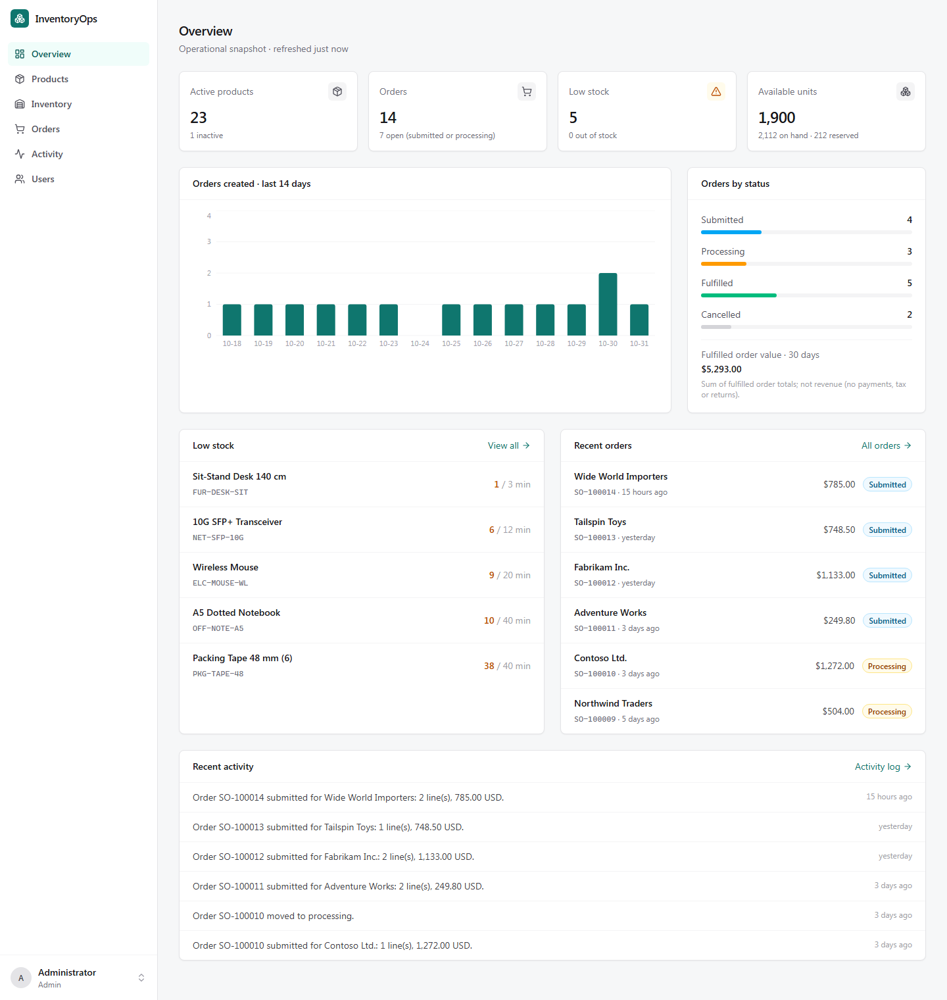 **Genel bakış** – backend'de hesaplanan metrikler, günlük sipariş grafiği, durum dağılımı, düşük stok listesi ve olay tabanlı aktivite akışı. | 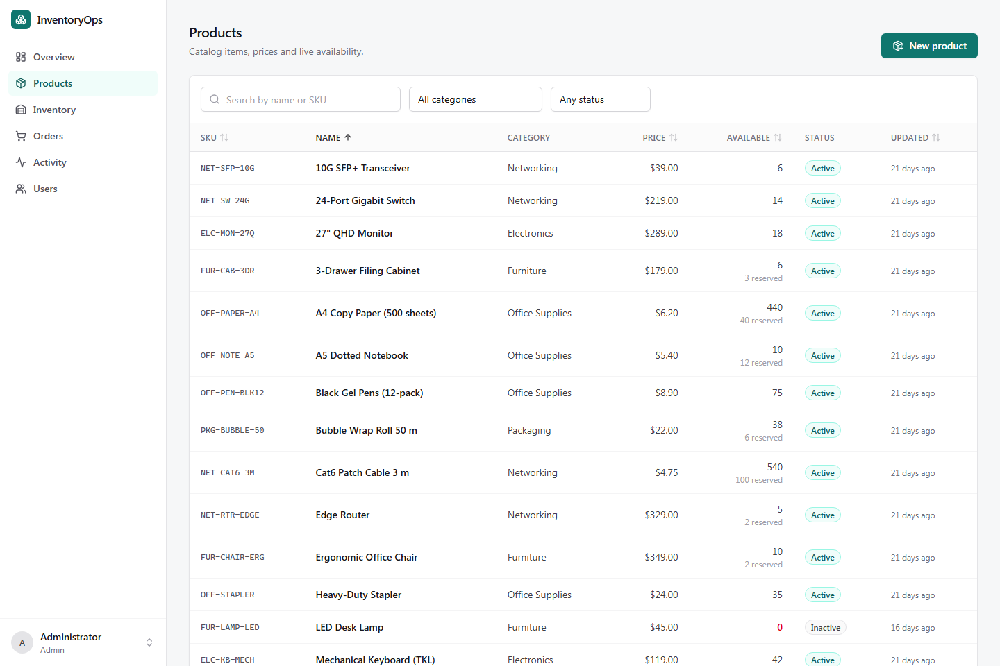 **Ürünler** – sunucu tarafında arama, filtre, izin listesiyle sınırlı sıralama ve sayfalama; canlı kullanılabilir/rezerve stok. |
| 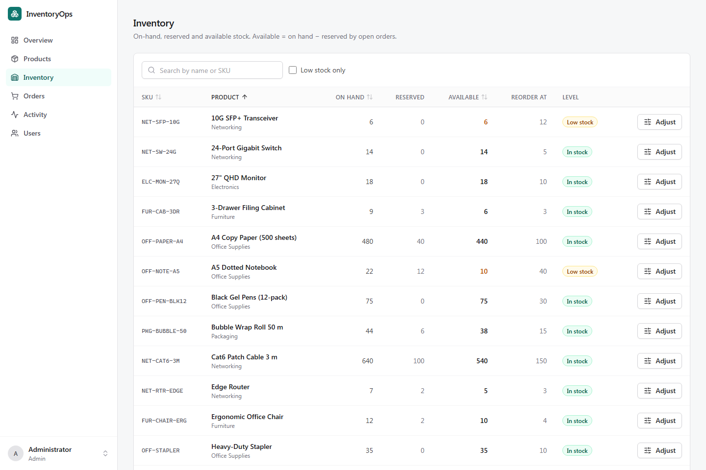 **Stok** – eldeki, rezerve ve kullanılabilir miktarlar, yeniden sipariş eşikleri ve stok düzeltmeleri. | 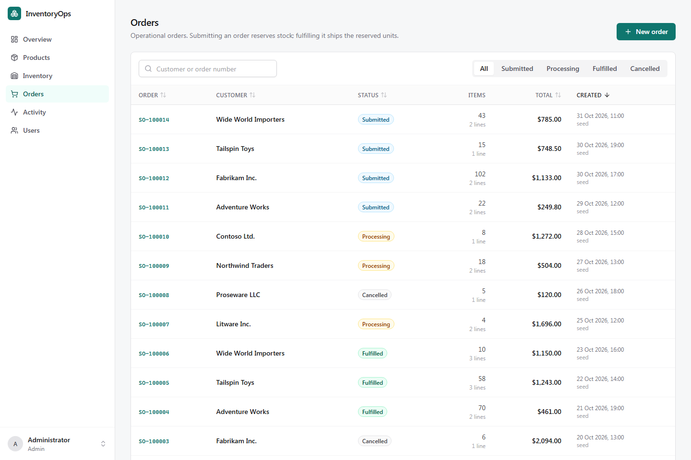 **Siparişler** – durum filtresi, müşteri veya sipariş numarasıyla arama. |
| 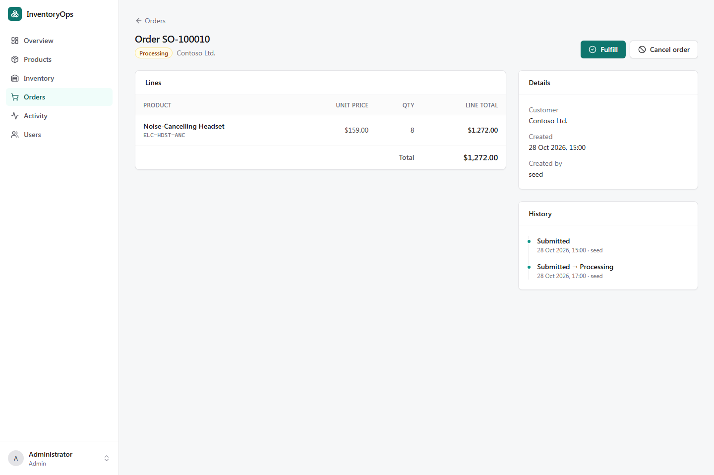 **Sipariş detayı** – fiyat anlık görüntülü satırlar, durum geçmişi ve yalnızca durum makinesinin izin verdiği geçişler. | 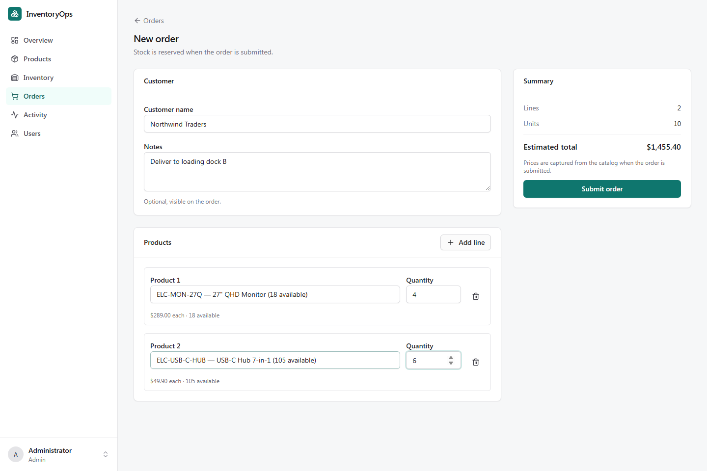 **Yeni sipariş** – stok durumu geri bildirimli çok satırlı giriş; stok, gönderimde rezerve edilir. |
| 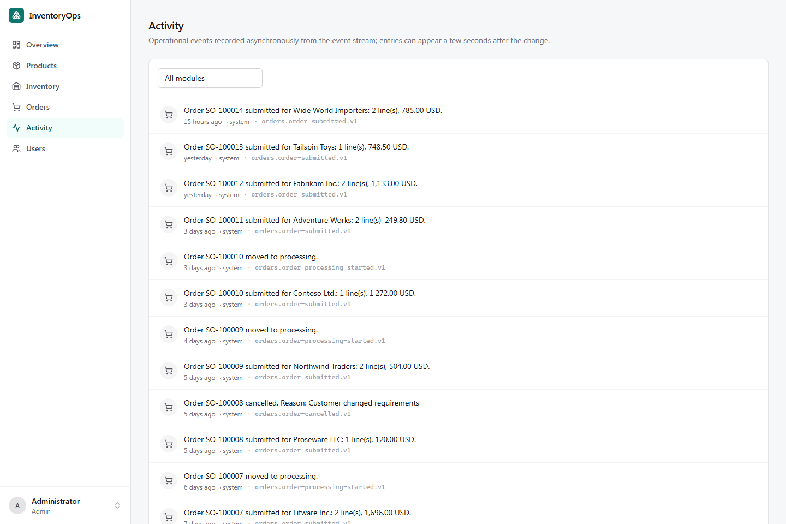 **Aktivite** – RabbitMQ olaylarından asenkron olarak üretilen kayıtlar. | 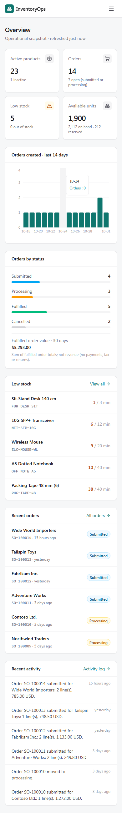 **Mobil** – navigasyon çekmeceli responsive düzen. |

## 3. Teknoloji yığını

| Alan | Teknoloji | Amaç |
|---|---|---|
| Backend | .NET 10, ASP.NET Core minimal API, nullable reference types ile C# | Modül tabanlı use case'lere sahip tek dağıtılabilir API |
| Doğrulama | FluentValidation | Alan bazında hata dönen komut/istek doğrulaması |
| Kimlik | ASP.NET Core Identity, cookie authentication, antiforgery | Parola hash'leme, hesap kilitleme, roller, oturumlar, CSRF |
| Loglama | Serilog (container'da JSON), correlation id'ler | HTTP ve mesajlaşma boyunca takip edilebilen yapısal loglar |
| API dokümanı | Microsoft.AspNetCore.OpenApi + Scalar UI | OpenAPI 3 dokümanı ve etkileşimli referans |
| Veritabanı | SQL Server 2022 (yerelde Developer Edition), EF Core 10 | Doğruluk kaynağı, transaction'lar, kısıtlar, migration'lar |
| Cache | Redis 7.4, StackExchange.Redis | Sık okunan, az değişen sorgular için cache-aside |
| Mesajlaşma | RabbitMQ 4.1 (quorum queue), RabbitMQ.Client 7 | Transactional outbox üzerinden asenkron entegrasyon olayları |
| Frontend | React 19, TypeScript (strict), Vite 7, React Router 7 | Günlük operasyonlar için SPA |
| Frontend veri/form | TanStack Query 5, React Hook Form, Zod 4 | Sunucu state cache/invalidation; istemci tarafı doğrulamalı tipli formlar |
| UI | Tailwind CSS 4, Radix UI primitive'leri (shadcn tarzı bileşenler), Lucide, Recharts, Sonner | Erişilebilir dialog/menüler, tutarlı tasarım sistemi, dashboard grafiği, bildirimler |
| Altyapı | Docker, Docker Compose, nginx (yetkisiz kullanıcı) | Tekrarlanabilir yerel ortam; aynı origin reverse proxy |
| Test | xUnit v3, Shouldly, Testcontainers, NetArchTest, Vitest + Testing Library, Playwright | Unit, entegrasyon (gerçek SQL Server/Redis/RabbitMQ), mimari, bileşen ve E2E testleri |
| CI | GitHub Actions | Format, analyzer'lar, testler, zafiyet taramaları, imaj derlemeleri |

## 4. Özellikler

**Tamamlananlar**

- **Kimlik ve erişim** – HttpOnly oturum cookie'si ile giriş, çıkış, arayüzde oturum süresinin dolmasının ele alınması, *Admin / Manager / Viewer* rolleri, admin kullanıcı yönetimi (oluşturma, rol değiştirme, pasifleştirme), hesap kilitleme, giriş rate limit'i.
- **Katalog** – ürün oluşturma/düzenleme/pasifleştirme/yeniden aktifleştirme, benzersiz SKU'lar, para birimli decimal fiyatlar, ad veya SKU ile arama, filtreler, sıralama, sunucu tarafı sayfalama, kategoriler.
- **Stok** – ürün başına eldeki / rezerve / kullanılabilir miktar, gerekçe ve notlu stok düzeltmeleri, yeniden sipariş eşikleri ve düşük stok işaretleri, değiştirilemez stok hareket geçmişi.
- **Siparişler** – fiyat anlık görüntülü çok satırlı siparişler, atomik stok rezervasyonu, idempotent gönderim, işleme alma, sevk (rezervasyonu tüketir), iptal (rezervasyonu serbest bırakır), durum geçmişi.
- **Dashboard** – aktif / düşük stoklu / stokta olmayan ürün sayıları, stok toplamları, duruma göre siparişler, günlük siparişler, son siparişler, sevk edilen sipariş tutarı (açıkça *ciro değildir*).
- **Aktivite akışı** – RabbitMQ mesajlarından asenkron olarak üretilen okunabilir olaylar.
- **Operasyonel** – health/readiness kontrolleri, correlation id'li yapısal loglar, OpenAPI dokümantasyonu, demo veriyle tek komutluk Docker ortamı.

Planlanan iyileştirmeler [bölüm 20](#20-kısıtlar-ve-gelecek-iyileştirmeler)'de listelenmiştir.

## 5. Sistem mimarisi

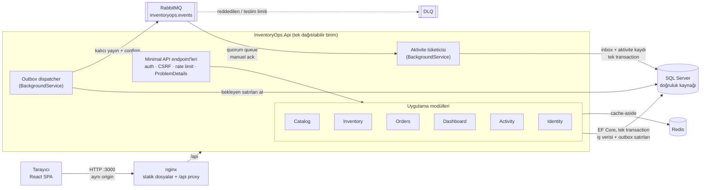

**Neden mikroservis değil de modüler monolit?** Modüller tek bir iş transaction'ını paylaşır: sipariş gönderimi katalog verisini doğrulamalı, stoğu rezerve etmeli ve siparişi *atomik olarak* oluşturmalıdır. Tek süreç ve tek veritabanıyla bu yerel bir SQL transaction'ıdır; servisler arasında ise saga, telafi işlemleri ve stok için eventual consistency gerekir — fazla satış hataları tam da burada ortaya çıkar. Hedef işletmenin ekip büyüklüğü ve yükü bağımsız dağıtımı haklı çıkarmaz. Modüller yine de katı sınırlara sahiptir (mimari testlerle zorunlu kılınır), böylece gerçek bir gerekçe doğarsa bir modül sonradan ayrılabilir. RabbitMQ ve Redis servis sınırı değil, destekleyici altyapıdır: yayıncı ve tüketici aynı API süreci içinde çalışır.

Ayrıntılar: [docs/ARCHITECTURE.md](docs/ARCHITECTURE.md).

## 6. Mimari kararlar

- **Katmanlar.** `Domain` (entity'ler, invariant'lar, domain olayları, framework referansı yok) ← `Application` (modül başına use case'ler, validator'lar, port'lar) ← `Infrastructure` (EF Core, Identity, Redis, RabbitMQ, arka plan işçileri) ← `Api` (composition root, HTTP). Bir bağımlılık yanlış yöne giderse mimari testler derlemeyi kırar.
- **Modüle göre dikey organizasyon.** Her modül (`Catalog`, `Inventory`, `Orders`, …) kendi komutlarına, sorgularına, port'larına ve DTO'larına sahiptir. "God class" servisler veya mediator kütüphanesi yerine küçük use case sınıfları (`SubmitOrderHandler`, `OrderWorkflow`, `InventoryCommands`): açık handler'lar yeterlidir ve çağrı yollarını görünür tutar.
- **Modül sözleşmeleri.** Orders modülü stok veya katalog entity'lerine hiç dokunmaz; bu modüllerin uyguladığı `IStockReservations` ve `ICatalogModule` arayüzlerini çağırır. Mimari testler modüllerin birbirine yalnızca `*.Contracts` üzerinden erişmesini zorunlu kılar.
- **Generic repository değil, persistence port'ları.** Aggregate'ler odaklı repository'lerle yüklenir (`IOrderRepository.GetAsync`, `IInventoryRepository.GetManyAsync`); ekranlar ise domain nesnesi oluşturmayan, yalnızca projeksiyon yapan read store'lardan beslenir (`IProductReadStore`, …).
- **Domain invariant'ları domain'de.** `InventoryItem` `OnHand ≥ 0`, `Reserved ≥ 0`, `Reserved ≤ OnHand` kurallarını; `Order` durum makinesini, satır kurallarını ve tek para birimini zorunlu kılar. SQL check constraint'leri bunları destekler.
- **Transaction sınırı = unit of work.** `IUnitOfWork.ExecuteAsync` bir use case'i tek SQL transaction'ına sarar ve row version çakışmalarında ve deadlock'larda (sınırlı, jitter'lı) yeniden dener. Domain olayları aynı `SaveChanges` içinde outbox satırlarına dönüşür.
- **Senkron ve asenkron iş.** Doğruluğu etkileyen her şey (stok, sipariş durumu) senkron ve transaction'lıdır. Yalnızca gecikebilecek yan etkiler (aktivite akışı, gelecekteki bildirimler/entegrasyonlar) asenkrondur.
- **Kimlik doğrulama.** Aynı origin'den sunulan birinci taraf SPA için HttpOnly, `SameSite=Strict` cookie ve antiforgery token'ları, tarayıcı depolamasındaki bearer token'lardan daha basit ve güvenlidir ([ADR 0004](docs/adr/0004-cookie-authentication.md)).
- **Dependency injection.** Yerleşik container; yaşam süreleri bilinçli seçildi (DbContext ve handler'lar scoped; Redis/RabbitMQ bağlantıları singleton; işçiler hosted service).

**Kabul edilen ödünleşimler.** Tek ortak `DbContext` modüller arası transaction'ları basitleştirir; ancak modül şemaları fiziksel izolasyonla değil, konvansiyon ve testlerle ayrılır. İş kuralı ihlalleri `Result` tipiyle değil exception'larla bildirilir; bu handler'ları kısa tutar, bedeli ise iş hataları için exception'ların akış kontrolü olarak kullanılmasıdır.

ADR'ler: [0001 modüler monolit](docs/adr/0001-modular-monolith.md) · [0002 stok eşzamanlılığı](docs/adr/0002-optimistic-concurrency-for-stock.md) · [0003 transactional outbox](docs/adr/0003-transactional-outbox.md) · [0004 cookie kimlik doğrulama](docs/adr/0004-cookie-authentication.md) · [0005 açık handler'lar, mediator yok](docs/adr/0005-explicit-handlers.md)

## 7. Proje yapısı

```text
.
├── backend/
│   ├── InventoryOps.slnx              # solution (merkezi paket yönetimi, lock dosyaları)
│   ├── src/
│   │   ├── InventoryOps.Domain/       # aggregate'ler, value object'ler, domain olayları (bağımlılık yok)
│   │   │   ├── Catalog/  Inventory/  Orders/  Activity/  Common/
│   │   ├── InventoryOps.Application/  # modül başına use case'ler, validator'lar, port'lar, olay sözleşmeleri
│   │   │   ├── Common/                # unit of work, cache, mesaj sözleşmeleri, sayfalama
│   │   │   └── Modules/{Catalog,Inventory,Orders,Dashboard,Activity,Identity}/
│   │   ├── InventoryOps.Infrastructure/ # EF Core, migration'lar, read store'lar, Identity, Redis, RabbitMQ, outbox, seed
│   │   └── InventoryOps.Api/          # Program, endpoint'ler, middleware, auth/CSRF/rate limit, health
│   ├── tests/
│   │   ├── InventoryOps.UnitTests/        # domain + application kuralları
│   │   ├── InventoryOps.IntegrationTests/ # Testcontainers SQL Server, Redis, RabbitMQ'ya karşı API
│   │   └── InventoryOps.ArchitectureTests/# bağımlılık ve modül sınırı kuralları
│   └── Dockerfile                     # çok aşamalı, chiseled ve root olmayan runtime imajı
├── frontend/
│   ├── src/
│   │   ├── app/                       # router, kabuk, route guard'ları
│   │   ├── features/{auth,dashboard,products,inventory,orders,activity,users}/
│   │   ├── components/{ui,shared}/    # tasarım sistemi primitive'leri ve ortak yapı taşları
│   │   ├── lib/  hooks/  types/  styles/
│   ├── e2e/                           # Playwright akışları + ekran görüntüsü alma
│   ├── nginx/                         # aynı origin proxy, güvenlik başlıkları
│   └── Dockerfile
├── compose.yaml / compose.dev.yaml    # tam ortam / isteğe bağlı loopback geliştirme portları
├── scripts/bootstrap.{sh,ps1}         # rastgele yerel secret'larla .env üretir
├── docs/                              # mimari, veritabanı, güvenlik, test, dağıtım, ADR'ler, ekran görüntüleri
└── .github/workflows/ci.yml
```

## 8. Veritabanı tasarımı

Tek SQL Server veritabanı, **modül başına bir şema**: `catalog`, `inventory`, `orders`, `activity`, `messaging`, `identity`.

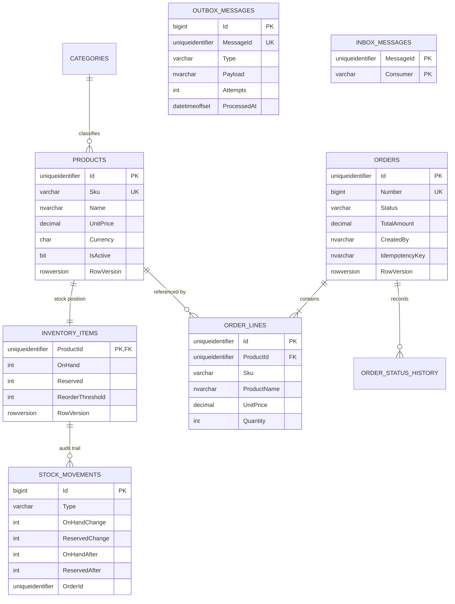

Temel kararlar:

- **Kısıtlar:** benzersiz SKU, benzersiz kategori adı, benzersiz `(CreatedBy, IdempotencyKey)`, sipariş başına benzersiz `(OrderId, ProductId)`, benzersiz `ActivityEntries.SourceMessageId`; negatif olmayan fiyat/toplam, pozitif miktar ve üç stok invariant'ı için check constraint'ler; kısıtlayıcı foreign key'ler (ürünler asla fiziksel olarak silinmez; satırlar kendi anlık görüntülerini tutar).
- **Para:** fiyatlar `decimal(12,2)`, toplamlar `decimal(14,2)`, ISO para birimi kodu; asla kayan nokta değil.
- **İndeksler:** SKU ve ad; kategori/durum; siparişler için `(Status, CreatedAt)` ve `CreatedAt`; stok hareketleri için `(ProductId, OccurredAt DESC)`; bekleyen outbox satırları için filtreli indeks; aktivite için `OccurredAt` ve `(Module, OccurredAt)`.
- **Anahtarlar:** domain'de üretilen GUID v7 id'ler. SQL Server `uniqueidentifier` değerlerini zaman bileşenine göre sıralamadığı için `Orders` tablosu **clustered olmayan PK** kullanır ve **sequence ile üretilen sipariş numarasına göre cluster'lanır**; yalnızca eklemeli log tabloları `bigint IDENTITY` anahtar kullanır.
- **Eşzamanlılık:** ürünlerde, stok kalemlerinde ve siparişlerde `rowversion` (domain modelinin dışında tutulan shadow property'ler).
- **İzolasyon:** `READ_COMMITTED_SNAPSHOT` etkindir, böylece okuyucular yazanları beklemez; iyimser kontroller yine de son commit edilmiş row version ile karşılaştırma yapar.
- **Migration'lar:** EF Core migration'ları, ayrı bir `migrator` container'ında çalışan tek seferlik `migrate` komutuyla uygulanır; hiçbir API instance'ı bunları otomatik uygulamaz.

Tüm ayrıntılar: [docs/DATABASE.md](docs/DATABASE.md).

## 9. Sipariş yaşam döngüsü

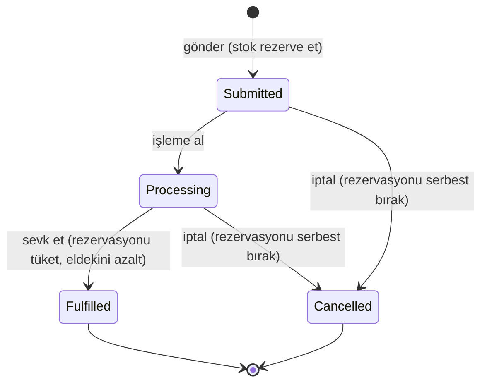

| Adım | Stok etkisi (aynı transaction) | Kaydedilenler |
|---|---|---|
| Gönder | Her satır için `Reserved += qty`; `qty > Available` ise reddedilir | sipariş, fiyat anlık görüntülü satırlar, geçmiş, hareketler, `orders.order-submitted.v1` |
| İşleme al | yok | geçmiş, `orders.order-processing-started.v1` |
| Sevk et | `Reserved -= qty`, `OnHand -= qty` | geçmiş, `Fulfillment` hareketleri, `orders.order-fulfilled.v1` |
| İptal et | `Reserved -= qty` | gerekçe, geçmiş, serbest bırakma hareketleri, `orders.order-cancelled.v1` |

Diğer tüm geçişler **409** (`orders.invalid_transition`) döner. İki kullanıcı aynı siparişi eşzamanlı sevk ederse: biri başarılı olur, diğerinin yeniden denemesi `Fulfilled` durumunu görür ve 409 alır — stok yalnızca bir kez tüketilir (bir entegrasyon testiyle doğrulanır).

**Sipariş gönderimi** ürünleri doğrular (var, aktif, tek para birimi), bir SQL sequence'inden sipariş numarası alır, fiyat anlık görüntüleriyle siparişi oluşturur ve tüm satırlar için stok rezerve eder — hepsi tek transaction'da. Tekrarlanan gönderimler zorunlu `Idempotency-Key` başlığıyla engellenir; anahtar kullanıcı bazındadır ve benzersiz indeks altında siparişin üzerinde saklanır (bkz. [ADR 0002](docs/adr/0002-optimistic-concurrency-for-stock.md) ve [docs/ARCHITECTURE.md](docs/ARCHITECTURE.md#idempotent-order-submission)).

## 10. RabbitMQ ve transactional outbox

Asenkron mesajlaşma, doğruluğu etkilemeden iş transaction'ının gerisinde kalabilecek işler için vardır — bugün aktivite akışı, yarın bildirimler veya entegrasyonlar. Stok rezervasyonu **asla** mesaj teslimatına bağlı değildir.

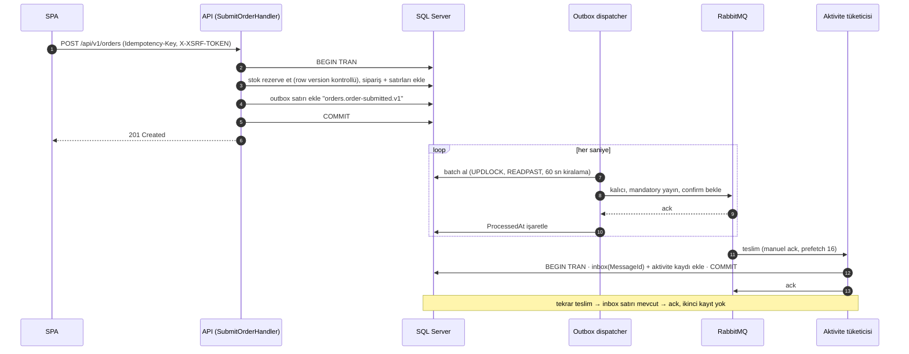

| Konu | Uygulama |
|---|---|
| Olay sözleşmeleri | Domain olaylarından `IntegrationEventMapper` ile eşlenen versiyonlu tip adları (`orders.order-submitted.v1`, `inventory.low-stock-detected.v1`, …); payload JSON, metadata AMQP property/header'larında (message id, tip, correlation id, aktör, oluşma zamanı). Kırıcı değişiklikler yeni bir `.v2` tipi ekler. |
| Outbox deposu | İş verisiyle aynı `SaveChanges` içinde yazılan `messaging.OutboxMessages`. |
| Yayınlama | Topic exchange `inventoryops.events` (durable), routing key = olay tipi, kalıcı mesajlar, `mandatory=true`, tracking'li publisher confirm (10 sn timeout). |
| Yeniden denemeler | Mesaja özgü hatalar (nack/yönlendirilemez) üstel olarak bekler (2ⁿ sn, en fazla 5 dk) ve 10 denemeden sonra **park edilir** (`DeadLetteredAt`, hata olarak loglanır). Broker kesintileri deneme hakkı **tüketmez**; satırlar sadece bekler. |
| Tüketici | `#` ile bağlanmış quorum queue `inventoryops.activity`, manuel ack, `x-delivery-limit=5`; bozuk mesajlar requeue olmadan reddedilir; geçici hatalar tekrar kuyruğa alınır. |
| Dead letter | `inventoryops.dlx` (fanout) → `inventoryops.activity.dlq`. |
| Idempotency | Aktivite kaydıyla aynı transaction'da eklenen `messaging.InboxMessages (MessageId, Consumer)` ve `ActivityEntries.SourceMessageId` üzerinde benzersiz indeks. |
| Teslim semantiği | Yayın ve teslimde **en az bir kez (at-least-once)**, tüketicide **etkin olarak bir kez** etki. Exactly-once vaadi yok, mesajlar arası sıralama garantisi yok. |

Gerçek bir broker'a karşı test edildi: uçtan uca akış, tekrarlanan teslimatlar, bozuk mesajların dead-letter'a düşmesi ve **duraklatılmış broker** senaryosu (yazmalar başarılı olmaya devam eder, outbox satırları hiç deneme tüketmeden bekler, broker geri geldiğinde olaylar teslim edilir).

## 11. Redis stratejisi

Redis okumaları hızlandırır; tek doğruluk kaynağı SQL Server'dır.

| Cache'lenen sorgu | Anahtar | TTL | Invalidation tetikleyicisi |
|---|---|---|---|
| Ürün detayı | `catalog:product:{id}:v1` | 5 dk | ürün güncelleme, aktifleştirme/pasifleştirme |
| Kategori listesi | `catalog:categories:v1` | 30 dk | ürün oluşturma/güncelleme, kategori oluşturma |
| Dashboard özeti | `dashboard:summary:v1` | 30 sn | her stok düzeltmesi, eşik değişikliği, sipariş gönderimi/geçişi, ürün oluşturma/(pasif)aktifleştirme |

- **Cache'lenmeyenler:** ürün listeleri (arama/filtre/sıralama kombinasyonlarının isabet oranı düşüktür ve canlı stok içerir), stok, siparişler, hareket geçmişi. **Stok durumu her zaman SQL Server'dan okunur** ve sipariş gönderimi transaction içinde veritabanına karşı doğrulanır.
- **Cache-aside:** oku → yoksa → SQL'den yükle → TTL ile sakla. Anahtarlar şema versiyonu son eki taşır; böylece DTO değişiklikleri dağıtım sonrası eski formatları okumaz.
- **Invalidation** transaction commit edildikten sonra çalışır. Cache-aside yarışı (bir okuyucunun bir yazmadan hemen önce okuduğu değerle cache'i yeniden doldurması) mümkündür; TTL'ler eskimeyi dashboard için 30 sn, ürün detayları için 5 dk ile sınırlar.
- **Hata davranışı:** multiplexer `abortConnect=false` ve 1 sn timeout'larla oluşturulur, bağlantı yokken atlanır. Okuma hataları "cache miss" sayılır, yazma/invalidation hataları uyarı olarak loglanır (yalnızca anahtarlar, asla değerler). Readiness, Redis'i *Unhealthy* değil *Degraded* olarak raporlar — bu, Redis'e erişilemezken API'yi çalıştıran bir entegrasyon testiyle doğrulanır.

## 12. Güvenlik mimarisi

| Alan | Uygulama |
|---|---|
| Kimlik doğrulama | ASP.NET Core Identity (PBKDF2 parola hash'leme), HttpOnly `SameSite=Strict` oturum cookie'si, 8 saat kayan süre, yapılandırılabilir `Secure` bayrağı (varsayılan açık; yalnızca yerel HTTP ortamında kapalı). Bilinmeyen hesaplar için süre eşitlenir; tüm hatalar tek genel mesaj döner. |
| Brute force | 5 hatalı denemeden sonra hesap kilitleme (15 dk) + istemci IP'si başına giriş rate limit'i (10/dk) + kullanıcı/IP başına genel limit (600/dk) → `Retry-After` ile `429`. |
| Oturum iptali | Rol değişiklikleri ve pasifleştirme security stamp'i yeniler; oturumlar dakikada bir yeniden doğrulanır. Pasif kullanıcılar giriş yapamaz. |
| Yetkilendirme | Her endpoint'te rol politikaları (`CanRead`, `CanOperate`, `CanViewActivity`, `CanManageUsers`) ve işaretlenmemiş her şey için **kimlik doğrulama gerektiren fallback politikası**. Admin'ler kendi rolünü düşüremez veya kendini pasifleştiremez; son aktif admin kaldırılamaz. Arayüz kontrolleri gizler, ama asıl otorite API'dir. |
| CSRF | Kullanıcıya bağlı antiforgery token'ları, `XSRF-TOKEN` cookie'si → `X-XSRF-TOKEN` başlığı ile double-submit; giriş dahil **her** güvenli olmayan istekte doğrulanır. |
| Girdi | Tüm komutlarda FluentValidation; bilinmeyen JSON alanları reddedilir (mass assignment koruması); sıralama alanları izin listesiyle sınırlı; sayfa boyutu ≤ 100; 1 MB istek gövdesi; yalnızca parametreli SQL (EF Core, interpolated `FromSql`, login oluşturmada parametre + `QUOTENAME`). |
| Hatalar | Kararlı `code` değerli RFC 9457 problem details; beklenmedik hatalarda stack trace veya exception mesajı yok (yalnızca correlation id). |
| Başlıklar | API: `nosniff`, `X-Frame-Options: DENY`, `Referrer-Policy: no-referrer`, kısıtlayıcı CSP, `Cache-Control: no-store`. SPA (nginx): inline/üçüncü taraf script içermeyen CSP ve aynı başlıklar. |
| Veritabanı | API, migrator'ın oluşturduğu **en az yetkili login** ile bağlanır (`db_datareader`, `db_datawriter`, sequence üzerinde `UPDATE`); `sa` yalnızca migrator tarafından kullanılır. |
| Secret'lar | Git'te gizli bilgi yok. `scripts/bootstrap`, git tarafından yok sayılan bir `.env` dosyasına rastgele parolalar üretir; compose bunlar olmadan başlamayı reddeder. Varsayılan admin parolası yoktur. |
| Container'lar | Chiseled .NET runtime (shell yok, root olmayan), yetkisiz nginx; SQL Server/Redis/RabbitMQ yalnızca `internal` Docker ağında; yalnızca frontend portu yayınlanır (varsayılan olarak loopback). Redis parola ister. |
| Loglama | Parolalar, cookie'ler, token'lar, connection string'ler veya istek gövdeleri loglanmaz; istek loglarında e-posta yerine kullanıcı id'si kullanılır. |
| Oturum anahtarları | Cookie ve antiforgery token'larını şifreleyen data-protection anahtarları SQL Server'da (`identity.DataProtectionKeys`) tutulur; oturumlar container yeniden oluşturulsa da korunur ve birden fazla instance arasında çalışır. |

Bilinen kısıtlar ve tehdit modeli: [docs/SECURITY.md](docs/SECURITY.md). Uygulama harici bir güvenlik incelemesinden geçmemiştir; testlerin geçmesi uygulamayı "güvenli" yapmaz.

## 13. API dokümantasyonu

- Base URL: `http://localhost:3000/api/v1` (nginx tarafından aynı origin'e proxy'lenir)
- Etkileşimli referans (Scalar): `http://localhost:3000/api/docs` · OpenAPI dokümanı: `/api/openapi/v1.json` (yerelde `OPENAPI_ENABLED` ile açık)
- Health: `GET /api/health/live`, `GET /api/health/ready`

| Grup | Endpoint'ler | Politika |
|---|---|---|
| Auth | `GET /auth/csrf`, `POST /auth/login`, `POST /auth/logout`, `GET /auth/me` | anonim / oturum açmış |
| Katalog | `GET/POST /products`, `GET/PUT /products/{id}`, `POST /products/{id}/deactivate, /activate`, `GET/POST /categories` | okuma: tüm roller · yazma: Admin, Manager |
| Stok | `GET /inventory`, `GET /inventory/{productId}`, `GET /inventory/{productId}/movements`, `POST /inventory/{productId}/adjustments`, `PUT /inventory/{productId}/reorder-threshold` | okuma: tüm roller · yazma: Admin, Manager |
| Siparişler | `GET/POST /orders`, `GET /orders/{id}`, `POST /orders/{id}/process, /fulfill, /cancel` | okuma: tüm roller · yazma: Admin, Manager |
| Dashboard | `GET /dashboard/summary` | tüm roller |
| Aktivite | `GET /activity?module=&severity=` | Admin, Manager |
| Kullanıcılar | `GET/POST /users`, `PUT /users/{id}/role`, `PUT /users/{id}/status` | Admin |

Örnek — sipariş gönderimi (cookie ve CSRF başlığı önceki girişten gelir):

```http
POST /api/v1/orders
Content-Type: application/json
X-XSRF-TOKEN: <XSRF-TOKEN cookie değeri>
Idempotency-Key: 6f1c2a7e-3a7b-4f0e-9a51-0c7d2d6c9b11

{ "customerName": "Northwind Traders", "notes": null,
  "lines": [ { "productId": "0198…", "quantity": 4 } ] }
```

```http
HTTP/1.1 201 Created
Location: /api/v1/orders/0198…

{ "id": "0198…", "number": "SO-100015", "status": "Submitted", "totalAmount": 1156.00, "currency": "USD",
  "lines": [ … ], "history": [ … ], "allowedTransitions": ["Processing", "Cancelled"] }
```

Aynı anahtarı aynı gövdeyle tekrar göndermek `200` ve orijinal siparişi döner; farklı bir gövdeyle `409 orders.idempotency_key_reused` döner.

Örnek — yetersiz stok:

```json
{
  "type": "https://tools.ietf.org/html/rfc9110#section-15.5.10",
  "title": "Insufficient stock",
  "status": 409,
  "detail": "Insufficient stock: requested 6, available 5.",
  "code": "inventory.insufficient_stock",
  "productId": "0198…", "requested": 6, "available": 5,
  "correlationId": "17aa67954e7749d99cebec0666db0e3e"
}
```

Standart hatalar: `400` doğrulama (alan bazında `errors`) / bozuk JSON / bilinmeyen alanlar / geçersiz CSRF token'ı, `401` kimlik doğrulanmamış, `403` yetkisiz, `404` bulunamadı, `409` çakışmalar (stok, tekrarlar, geçersiz geçişler, tükenen eşzamanlılık denemeleri, idempotency uyuşmazlığı), `422` iş kuralı (ör. pasif ürün), `429` rate limit, `500` beklenmedik hata (genel mesaj + correlation id).

## 14. Docker kurulumu

**Gereksinimler:** Docker Desktop (Windows/macOS) veya Docker Engine + Compose v2 (Linux), Docker için ~4 GB RAM, 3000 portunun boş olması. SQL Server imajı yalnızca `linux/amd64` içindir; Apple Silicon'da emülasyonla çalışır (bkz. [docs/DEPLOYMENT.md](docs/DEPLOYMENT.md)).

```bash
git clone https://github.com/Erenen1/inventory-ops.git
```

```bash
cd inventory-ops
```

Yerel secret'ları üretin (git tarafından yok sayılan bir `.env` oluşturur; mevcut dosyanın üzerine asla yazmaz):

```bash
sh scripts/bootstrap.sh
```

Windows PowerShell'de:

```bash
powershell -ExecutionPolicy Bypass -File scripts/bootstrap.ps1
```

Her şeyi derleyip başlatın (ilk çalıştırma imajları indirir ve birkaç dakika sürer):

```bash
docker compose up -d --build
```

Compose önce SQL Server, Redis ve RabbitMQ'yu başlatır ve health check'lerini bekler; ardından tek seferlik **migrator**'ı çalıştırır (migration'lar, read committed snapshot, en az yetkili SQL login'i, admin kullanıcı, `SEED_DEMO_DATA=true` ise demo veri ve demo kullanıcılar); API hazır olduğunu bildirdiğinde de API'yi ve nginx frontend'i başlatır.

Doğrulama:

```bash
docker compose ps
```

```bash
curl http://localhost:3000/api/health/ready
```

**http://localhost:3000** adresini açın ve `.env` içindeki `ADMIN_EMAIL` / `ADMIN_PASSWORD` ile giriş yapın (demo Manager ve Viewer hesapları da orada listelenir).

| URL | Amaç |
|---|---|
| http://localhost:3000 | Uygulama |
| http://localhost:3000/api/docs | API referansı (yerel) |
| http://localhost:3000/api/health/ready | Readiness (SQL Server, Redis, RabbitMQ) |

Durdurma (veriler named volume'larda korunur):

```bash
docker compose down
```

**Tüm yerel verileri** sıfırlama (volume'ları siler; sonraki `up` demo veriyi yeniden yükler):

```bash
docker compose down -v
```

İsteğe bağlı: API'yi IDE'den çalıştırmak için altyapıyı yalnızca `127.0.0.1` üzerinde açın (SQL `14333`, Redis `16379`, AMQP `15672`, RabbitMQ UI `15673`):

```bash
docker compose -f compose.yaml -f compose.dev.yaml up -d sqlserver redis rabbitmq
```

## 15. Testler

| Katman | Proje | Neyi doğrular | Altyapı |
|---|---|---|---|
| Unit (60) | `backend/tests/InventoryOps.UnitTests` | Stok invariant'ları ve hareketleri, sipariş durum makinesi, decimal toplamlar, SKU/para kuralları, validator'lar, istek hash'leme, olay sözleşmeleri, aktivite projeksiyonu | yok |
| Mimari (9) | `backend/tests/InventoryOps.ArchitectureTests` | Katman yönü, modül sınırları yalnızca sözleşmeler üzerinden, ince endpoint'ler, domain tiplerinde public setter yok | yok |
| Entegrasyon (55) | `backend/tests/InventoryOps.IntegrationTests` | **Testcontainers'daki SQL Server, Redis ve RabbitMQ'ya** karşı HTTP üzerinden gerçek API: kimlik doğrulama, CSRF, rol matrisi, yetki yükseltme, hesap kilitleme, rate limit, doğrulama, mass assignment, sayfalama limitleri, eşzamanlı tekrarlanan SKU'lar, check constraint'ler, idempotency (eşzamanlı tekrarlar dahil), **10 birimlik stoğa 30 eşzamanlı sipariş asla fazla satış yapmaz**, eşzamanlılık altında tek sevk, cache invalidation, Redis kesintisi, outbox → broker → tüketici, tekrarlanan teslimatlar, DLQ, duraklatılmış broker sonrası toparlanma | Docker |
| Frontend (22) | `frontend/src/**/*.test.tsx` (Vitest + Testing Library) | Form şemaları, istemci doğrulaması, sunucu hatalarının forma eşlenmesi, CSRF + idempotency başlıkları, yeniden denemede aynı idempotency anahtarı, role göre navigasyon, yükleniyor/boş/hata durumları | yok |
| E2E (4 + ekran görüntüleri) | `frontend/e2e` (Playwright) | Giriş, dashboard, ürün oluşturma, stok girişi, sipariş rezervasyonu, işleme alma ve sevk, stok ekranının güncellenmesi, Viewer kısıtlamaları arayüzde **ve** API'de, çıkış, geçersiz kimlik bilgileri. Doğrulamalar durumu API üzerinden geri okur; konsol hataları testi başarısız kılar. | çalışan Docker ortamı |

Komutlar:

```bash
cd backend && dotnet test --project tests/InventoryOps.UnitTests
```

```bash
cd backend && dotnet test --project tests/InventoryOps.ArchitectureTests
```

```bash
cd backend && dotnet test --project tests/InventoryOps.IntegrationTests
```

```bash
cd frontend && npm ci && npm test
```

```bash
cd frontend && npx playwright install chromium && npx playwright test --project=workflows
```

Kapsam (coverage) yüzdesi yayınlanmaz; testler bir sayıyı değil davranışı ve hata senaryolarını hedefler. Ayrıntılar: [docs/TESTING.md](docs/TESTING.md).

## 16. CI pipeline

[`.github/workflows/ci.yml`](.github/workflows/ci.yml), `main`'e yapılan push'larda ve pull request'lerde salt okunur izinlerle ve SHA ile sabitlenmiş action'larla çalışır:

- **Backend:** locked restore → `dotnet format --verify-no-changes` → analyzer/uyarıların hata sayıldığı Release derlemesi → unit, mimari ve Testcontainers entegrasyon testleri → NuGet zafiyet taraması (transitive dahil).
- **Frontend:** `npm ci` → Prettier kontrolü → ESLint (strict type-checked) → `tsc` → Vitest → production build → `npm audit` (production bağımlılıkları için *high* seviyesinde engelleyici; tam rapor engelleyici değil).
- **Docker:** geçici secret'larla compose doğrulaması, API ve frontend imaj derlemeleri (push yok).

Her adım commit'ten önce yerelde çalıştırıldı; workflow'un kendisi depo GitHub'a push'landığında çalışır. Hedef bir ortam olmadığı için deployment job'ı yoktur. Playwright E2E tam ortama ihtiyaç duyar ve yerelde çalıştırılır (bkz. [docs/TESTING.md](docs/TESTING.md)).

## 17. Gözlemlenebilirlik

- **Yapısal loglar:** Serilog, container'larda compact JSON, her HTTP isteği için bir tamamlanma olayı (method, path, status, süre, kullanıcı id'si).
- **Correlation id'ler:** `X-Correlation-ID` başlığından (doğrulanarak) alınır veya üretilir; her yanıtta döner, her log olayına ve her ProblemDetails gövdesine eklenir, outbox mesajlarında saklanır, AMQP `correlation_id` olarak taşınır ve tüketicinin log scope'unda geri yüklenir — tek bir id, arayüzdeki bir hatayı isteğe, olaya ve projeksiyonuna bağlar.
- **Health:** `/api/health/live` (süreç) ve `/api/health/ready` (SQL Server sağlıklı olmalı; Redis/RabbitMQ zarifçe degrade olur). Container'lar bunları Compose health check'leri için kullanır.
- **Bir hatayı incelemek:** hata bildiriminden/yanıttan correlation id'yi alın → `docker compose logs api | grep <id>` → mesajlaşma sorunları için `messaging.OutboxMessages` (`Attempts`, `LastError`, `DeadLetteredAt`) tablosunu ve `inventoryops.activity.dlq` kuyruğunu inceleyin.

## 18. Performans ve güvenilirlik

- Her yerde sunucu tarafı sayfalama (en fazla 100 satır), deterministik ikincil sıralamalı izin listesi tabanlı sıralama, `AsNoTracking` ile doğrudan DTO'lara projeksiyon, N+1 sorgu yok (sipariş listeleri tek sorguda ilişkili agregasyon kullanır; kullanıcı rolleri tek sorguda join edilir).
- Her listenin filtre/sıralama desenine uygun indeksler; outbox sorgusu için filtreli indeks; siparişler monoton artan numaraya göre cluster'lanır.
- `READ_COMMITTED_SNAPSHOT`, okumaların stok yazmalarını beklemesini önler.
- Row version çakışmaları ve deadlock'lar için sınırlı iyimser eşzamanlılık denemeleri (6 deneme, jitter'lı üstel bekleme); çok satırlı rezervasyonda deterministik ürün sırası.
- Ürün detayları, kategoriler ve dashboard özeti için cache-aside.
- Outbox batch'leri (50), `READPAST` ile kiralama sayesinde birden fazla API instance'ı eşzamanlı dağıtım yapabilir, yayın timeout'u, sınırlı denemeler.
- SPA'da route bazlı code splitting, fingerprint'li varlıkların değişmez cache'lenmesi.

Performans rakamı iddia edilmez: yük testi veya benchmark yapılmamıştır.

## 19. Mühendislik ödünleşimleri

- **Mikroservis yok:** bu ölçekteki bir problem için "doğrula + rezerve et + sipariş oluştur" işinin tek transaction'da yapılması saga'dan daha iyidir. Modüller sınırlarını korur, böylece ayrıştırma mümkün kalır.
- **Kubernetes yok:** Compose çalışma zamanı topolojisini gösterir; gerçek bir dağıtım hedefi olmadan orkestrasyon bir şey katmaz.
- **CQRS framework'ü veya MediatR yok:** read store'lar ve açık handler'lar aynı ayrımı daha az dolaylılıkla sağlar ([ADR 0005](docs/adr/0005-explicit-handlers.md)).
- **Stok tutarlılığından SQL Server sorumlu:** tek ACID depoda row version'lar + check constraint'ler; Redis asla yetkili stok tutmaz.
- **Rezervasyonlarda RabbitMQ kullanılmaz:** gönderim anında senkron bir yanıt ("rezerve edildi mi") gerekir; mesajlaşma kritik yola gecikme ve hata modları ekler.
- **Pessimistic kilitler veya ham koşullu `UPDATE`'ler yerine iyimser eşzamanlılık:** kuralları domain modelinde tutar; bedeli tek bir SKU üzerinde yoğun çekişmede yeniden denemelerdir ([ADR 0002](docs/adr/0002-optimistic-concurrency-for-stock.md)).
- **Tek ortak `DbContext`:** basit modüller arası transaction'lar; modül izolasyonu ayrı veritabanlarıyla değil, şemalar, sözleşmeler ve testlerle sağlanır.

## 20. Kısıtlar ve gelecek iyileştirmeler

Mevcut kısıtlar (bilinçli veya henüz yapılmamış):

- Sipariş formu en fazla 100 aktif ürün yükler (API'nin sayfa boyutu sınırı); bir sonraki adım aranabilir bir ürün seçicidir.
- Aynı formu düzenleyen iki kullanıcı arasında ürün düzenlemelerinde son yazan kazanır (`ETag`/`If-Match` yok); sunucu tarafı yazmaların kendisi row version'larla korunur.
- Kullanıcının kendi parolasını değiştirmesi/sıfırlaması, e-posta akışları ve MFA yok; ilk parolaları admin'ler belirler.
- Kategoriler API üzerinden oluşturulabilir ancak yönetim ekranı yoktur; ürün görseli veya özellik desteği yoktur.
- Park edilmiş outbox mesajları ve DLQ mesajları manuel inceleme/yeniden gönderme gerektirir (araç yok); outbox/inbox tabloları için henüz saklama (retention) job'ı yoktur.
- Olaylar arasında sıralama garantisi yoktur; tüketiciler sıralamadan bağımsız kalmalıdır.
- Tek depo, sipariş başına tek para birimi, iade/bekleyen sipariş/kısmi sevk yok.
- Yerel ortam düz HTTP üzerinde çalışır; gerçek bir dağıtımda nginx'in önünde TLS sonlandırması beklenir (bkz. [docs/DEPLOYMENT.md](docs/DEPLOYMENT.md)).
- Data-protection anahtarları veritabanında şifrelenmeden saklanır; production için sertifika veya key vault ile koruma eklenmelidir.
- Yalnızca geliştirme ortamına ait npm uyarısı: ESLint 9, ReDoS uyarısı bulunan bir `minimatch` sürümüne bağımlıdır (yalnızca geliştirme araçları; production bağımlılık denetimi temizdir).

Gelecek iyileştirmeler: aranabilir ürün seçici, düzenlemeler için ETag'ler, outbox/inbox saklama süresi ve yeniden gönderme aracı, OpenTelemetry trace/metrikleri, parola yönetimi ve MFA, çoklu depo stoğu, kısmi sevk, yük testleri.

## 21. Lisans

[MIT](LICENSE)
