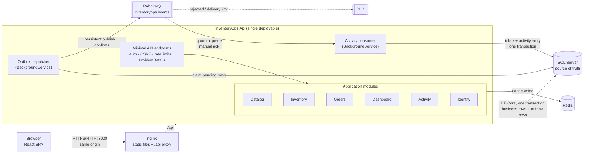
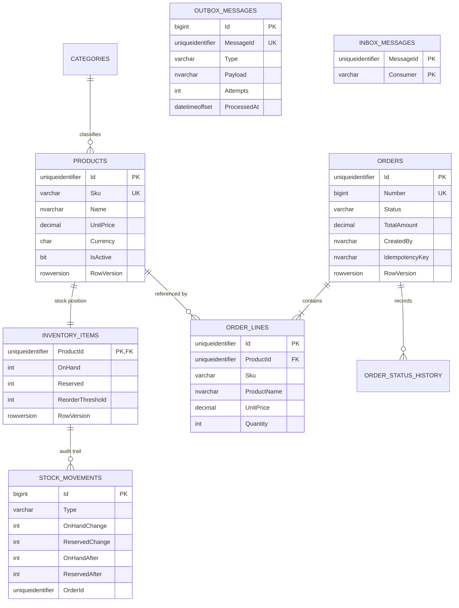
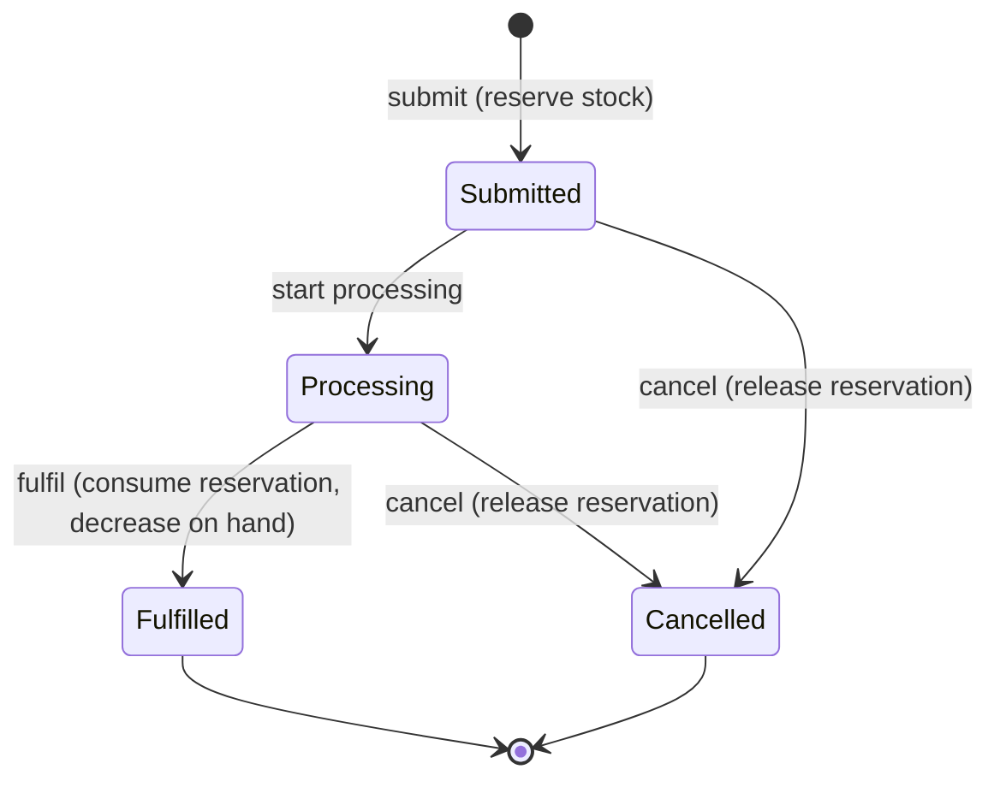
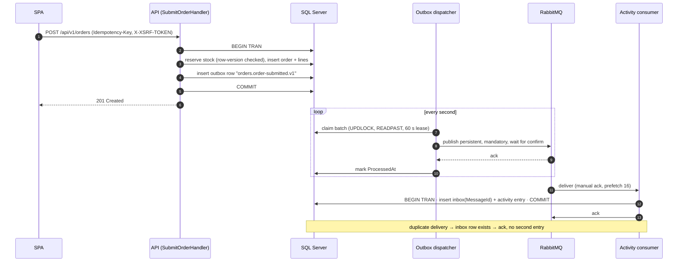

# InventoryOps

InventoryOps is a full-stack inventory and order management system for a small or medium-sized business. Staff maintain a product catalog, receive and adjust stock, take customer orders that **reserve stock atomically**, and process those orders through to fulfilment, while an asynchronous activity feed records what happened.

It is a portfolio project built to show how a **.NET modular monolith** handles the hard parts of this domain: stock that must never be oversold under concurrency, reliable event publishing (transactional outbox), idempotent consumers, cache-aside reads with safe invalidation, cookie-based authentication with CSRF protection, and a reproducible Docker environment, all covered by automated tests against real infrastructure.

**Scope.** Catalog, inventory, orders, dashboard, activity feed and user/role administration. Orders are operational (reserve → ship); there are no payments, invoices, tax, shipping carriers or multi-warehouse stock. See [Limitations](#20-limitations-and-future-improvements).

## Contents

1. [Screenshots](#2-screenshots) · 2. [Technology stack](#3-technology-stack) · 3. [Features](#4-features) · 4. [System architecture](#5-system-architecture) · 5. [Architecture decisions](#6-architecture-decisions) · 6. [Project structure](#7-project-structure) · 7. [Database design](#8-database-design) · 8. [Order lifecycle](#9-order-lifecycle) · 9. [RabbitMQ and the outbox](#10-rabbitmq-and-the-transactional-outbox) · 10. [Redis strategy](#11-redis-strategy) · 11. [Security](#12-security-architecture) · 12. [API](#13-api-documentation) · 13. [Docker setup](#14-docker-setup) · 14. [Testing](#15-testing) · 15. [CI](#16-ci-pipeline) · 16. [Observability](#17-observability) · 17. [Performance and reliability](#18-performance-and-reliability) · 18. [Trade-offs](#19-engineering-trade-offs) · 19. [Limitations](#20-limitations-and-future-improvements) · 20. [License](#21-license)

Detailed documents: [Architecture](docs/ARCHITECTURE.md) · [Database](docs/DATABASE.md) · [Security](docs/SECURITY.md) · [Testing](docs/TESTING.md) · [Deployment](docs/DEPLOYMENT.md) · [ADRs](docs/adr/)

---

## 2. Screenshots

All screenshots are captured by Playwright (`frontend/e2e/screenshots.spec.ts`) from the running Docker stack with the deterministic demo dataset.

| | |
|---|---|
|  **Overview** – backend-computed metrics, orders per day, status breakdown, low-stock list and the event-driven activity feed. |  **Products** – server-side search, filters, allow-listed sorting and pagination, with live available/reserved stock. |
|  **Inventory** – on hand, reserved and available quantities with reorder thresholds and stock adjustments. |  **Orders** – status filter, search by customer or order number. |
|  **Order details** – price-snapshot lines, status history and only the transitions the state machine allows. |  **New order** – multi-line entry with availability feedback; stock is reserved on submit. |
|  **Activity** – entries projected asynchronously from RabbitMQ events. |  **Mobile** – responsive layout with a navigation drawer. |

## 3. Technology stack

| Area | Technology | Purpose |
|---|---|---|
| Backend | .NET 10, ASP.NET Core minimal APIs, C# with nullable reference types | Single deployable API with module-based use cases |
| Validation | FluentValidation | Request/command validation returning field-level errors |
| Identity | ASP.NET Core Identity, cookie authentication, antiforgery | Password hashing, lockout, roles, sessions, CSRF |
| Logging | Serilog (JSON in containers), correlation ids | Structured logs that can be followed across HTTP and messaging |
| API docs | Microsoft.AspNetCore.OpenApi + Scalar UI | OpenAPI 3 document and interactive reference |
| Database | SQL Server 2022 (Developer Edition locally), EF Core 10 | Source of truth, transactions, constraints, migrations |
| Caching | Redis 7.4, StackExchange.Redis | Cache-aside for read-heavy, low-volatility queries |
| Messaging | RabbitMQ 4.1 (quorum queues), RabbitMQ.Client 7 | Asynchronous integration events via a transactional outbox |
| Frontend | React 19, TypeScript (strict), Vite 7, React Router 7 | SPA for daily operations |
| Frontend data/forms | TanStack Query 5, React Hook Form, Zod 4 | Server-state caching/invalidation; typed forms with client-side validation |
| UI | Tailwind CSS 4, Radix UI primitives (shadcn-style components), Lucide, Recharts, Sonner | Accessible dialogs/menus, consistent design system, dashboard chart, toasts |
| Infrastructure | Docker, Docker Compose, nginx (unprivileged) | Reproducible local stack; same-origin reverse proxy |
| Testing | xUnit v3, Shouldly, Testcontainers, NetArchTest, Vitest + Testing Library, Playwright | Unit, integration (real SQL Server/Redis/RabbitMQ), architecture, component and E2E tests |
| CI | GitHub Actions | Format, analyzers, tests, vulnerability scans, image builds |

## 4. Features

**Implemented**

- **Identity & access** – sign-in with HttpOnly session cookie, logout, session expiry handling in the UI, roles *Admin / Manager / Viewer*, admin user management (create, change role, deactivate), account lockout, login rate limiting.
- **Catalog** – create/edit/deactivate/reactivate products, unique SKUs, decimal prices with currency, search by name or SKU, filters, sorting, server-side pagination, categories.
- **Inventory** – on hand / reserved / available per product, stock adjustments with reasons and notes, reorder thresholds and low-stock flags, immutable stock-movement history.
- **Orders** – multi-line orders with price snapshots, atomic stock reservation, idempotent submission, processing, fulfilment (consumes reservations), cancellation (releases reservations), status history.
- **Dashboard** – active/low-stock/out-of-stock counts, stock totals, orders by status, orders per day, recent orders, fulfilled order value (explicitly *not* revenue).
- **Activity feed** – human-readable events projected asynchronously from RabbitMQ messages.
- **Operational** – health/readiness checks, structured logs with correlation ids, OpenAPI documentation, one-command Docker environment with demo data.

Planned improvements are listed in [section 20](#20-limitations-and-future-improvements).

## 5. System architecture



**Why a modular monolith, not microservices.** The modules share one business transaction: submitting an order must validate catalog data, reserve stock and create the order *atomically*. In one process with one database that is a local SQL transaction; across services it would need sagas, compensations and eventual consistency for stock, which is exactly where overselling bugs appear. The team size and load of the target business do not justify independent deployment. Modules still have hard boundaries (enforced by architecture tests), so a module could be extracted later if a real reason appears. RabbitMQ and Redis are supporting infrastructure, not service boundaries: the publisher and the consumer run inside the same API process.

More detail: [docs/ARCHITECTURE.md](docs/ARCHITECTURE.md).

## 6. Architecture decisions

- **Layers.** `Domain` (entities, invariants, domain events, no framework references) ← `Application` (use cases per module, validators, ports) ← `Infrastructure` (EF Core, Identity, Redis, RabbitMQ, background workers) ← `Api` (composition root, HTTP). Architecture tests fail the build if a dependency points the wrong way.
- **Vertical organisation by module.** Each module (`Catalog`, `Inventory`, `Orders`, …) owns its commands, queries, ports and DTOs. Small use-case classes (`SubmitOrderHandler`, `OrderWorkflow`, `InventoryCommands`) instead of service "god classes" or a mediator library: explicit handlers are enough and keep call paths obvious.
- **Module contracts.** Orders never touches inventory or catalog entities. It calls `IStockReservations` and `ICatalogModule`, which those modules implement. Architecture tests enforce that modules only reach each other through `*.Contracts`.
- **Persistence ports, not a generic repository.** Aggregates are loaded through focused repositories (`IOrderRepository.GetAsync`, `IInventoryRepository.GetManyAsync`); screens are served by projection-only read stores (`IProductReadStore`, …) that never materialise domain objects.
- **Domain invariants in the domain.** `InventoryItem` enforces `OnHand ≥ 0`, `Reserved ≥ 0`, `Reserved ≤ OnHand`; `Order` enforces its state machine, line rules and single currency. SQL check constraints back them up.
- **Transaction boundary = unit of work.** `IUnitOfWork.ExecuteAsync` wraps a use case in one SQL transaction and retries it on row-version conflicts and deadlocks (bounded, jittered). Domain events become outbox rows inside the same `SaveChanges`.
- **Synchronous vs asynchronous.** Everything that affects correctness (stock, order state) is synchronous and transactional. Only side effects that may lag (activity feed, future notifications/integrations) are asynchronous.
- **Authentication.** First-party SPA served from the same origin, so an HttpOnly, `SameSite=Strict` cookie plus antiforgery tokens is simpler and safer than bearer tokens in browser storage ([ADR 0004](docs/adr/0004-cookie-authentication.md)).
- **Dependency injection.** Built-in container; lifetimes chosen deliberately (DbContext and handlers scoped; Redis/RabbitMQ connections singletons; workers hosted services).

**Trade-offs accepted.** One shared `DbContext` makes cross-module transactions trivial but means module schemas are separated by convention and tests, not by physical isolation. Exceptions (not a `Result` type) signal rule violations; this keeps handlers short at the cost of exceptions as control flow for business errors.

ADRs: [0001 modular monolith](docs/adr/0001-modular-monolith.md) · [0002 stock concurrency](docs/adr/0002-optimistic-concurrency-for-stock.md) · [0003 transactional outbox](docs/adr/0003-transactional-outbox.md) · [0004 cookie authentication](docs/adr/0004-cookie-authentication.md) · [0005 explicit handlers, no mediator](docs/adr/0005-explicit-handlers.md)

## 7. Project structure

```text
.
├── backend/
│   ├── InventoryOps.slnx              # solution (central package management, lock files)
│   ├── src/
│   │   ├── InventoryOps.Domain/       # aggregates, value objects, domain events (no dependencies)
│   │   │   ├── Catalog/  Inventory/  Orders/  Activity/  Common/
│   │   ├── InventoryOps.Application/  # use cases per module, validators, ports, event contracts
│   │   │   ├── Common/                # unit of work, caching, messaging contracts, paging
│   │   │   └── Modules/{Catalog,Inventory,Orders,Dashboard,Activity,Identity}/
│   │   ├── InventoryOps.Infrastructure/ # EF Core, migrations, read stores, Identity, Redis, RabbitMQ, outbox, seeding
│   │   └── InventoryOps.Api/          # Program, endpoints, middleware, auth/CSRF/rate limits, health
│   ├── tests/
│   │   ├── InventoryOps.UnitTests/        # domain + application rules
│   │   ├── InventoryOps.IntegrationTests/ # API against Testcontainers SQL Server, Redis, RabbitMQ
│   │   └── InventoryOps.ArchitectureTests/# dependency and module boundary rules
│   └── Dockerfile                     # multi-stage, chiseled non-root runtime image
├── frontend/
│   ├── src/
│   │   ├── app/                       # router, shell, route guards
│   │   ├── features/{auth,dashboard,products,inventory,orders,activity,users}/
│   │   ├── components/{ui,shared}/    # design-system primitives and shared building blocks
│   │   ├── lib/  hooks/  types/  styles/
│   ├── e2e/                           # Playwright workflows + screenshot capture
│   ├── nginx/                         # same-origin proxy, security headers
│   └── Dockerfile
├── compose.yaml / compose.dev.yaml    # full stack / optional loopback-only dev ports
├── scripts/bootstrap.{sh,ps1}         # generates .env with random local secrets
├── docs/                              # architecture, database, security, testing, deployment, ADRs, screenshots
└── .github/workflows/ci.yml
```

## 8. Database design

One SQL Server database with **one schema per module**: `catalog`, `inventory`, `orders`, `activity`, `messaging`, `identity`.



Key decisions:

- **Constraints:** unique SKU, unique category name, unique `(CreatedBy, IdempotencyKey)`, unique `(OrderId, ProductId)` per order, unique `ActivityEntries.SourceMessageId`; check constraints for non-negative prices/totals, positive quantities and the three stock invariants; restrictive foreign keys (products are never hard-deleted; lines keep their own snapshots).
- **Money:** `decimal(12,2)` prices, `decimal(14,2)` totals, ISO currency code; never floating point.
- **Indexes:** SKU and name; category/status; orders by `(Status, CreatedAt)` and `CreatedAt`; stock movements by `(ProductId, OccurredAt DESC)`; a filtered index for pending outbox rows; activity by `OccurredAt` and `(Module, OccurredAt)`.
- **Keys:** GUID v7 ids generated in the domain. Because SQL Server does not order `uniqueidentifier` by its time component, `Orders` uses a **non-clustered PK** and is **clustered on the sequence-generated order number**; append-only logs use `bigint IDENTITY` keys.
- **Concurrency:** `rowversion` on products, inventory items and orders (shadow properties, kept out of the domain model).
- **Isolation:** `READ_COMMITTED_SNAPSHOT` is enabled so readers do not block on writers; optimistic checks still compare against the latest committed row version.
- **Migrations:** EF Core migrations, applied by a one-shot `migrate` command (separate `migrator` container), never automatically by every API instance.

Full details: [docs/DATABASE.md](docs/DATABASE.md).

## 9. Order lifecycle



| Step | Stock effect (same transaction) | Recorded |
|---|---|---|
| Submit | `Reserved += qty` for every line, rejected if `qty > Available` | order, lines with price snapshots, history, movements, `orders.order-submitted.v1` |
| Start processing | none | history, `orders.order-processing-started.v1` |
| Fulfil | `Reserved -= qty`, `OnHand -= qty` | history, `Fulfillment` movements, `orders.order-fulfilled.v1` |
| Cancel | `Reserved -= qty` | reason, history, release movements, `orders.order-cancelled.v1` |

Any other transition returns **409** (`orders.invalid_transition`). Two users fulfilling the same order concurrently: one succeeds, the other's retry sees `Fulfilled` and receives 409 — stock is consumed once (covered by an integration test).

**Order submission** validates products (exist, active, single currency), allocates an order number from a SQL sequence, creates the order with price snapshots and reserves stock for all lines — in one transaction. Duplicate submissions are prevented by a required `Idempotency-Key` header, scoped per user and stored on the order under a unique index (see [ADR 0002](docs/adr/0002-optimistic-concurrency-for-stock.md) and [docs/ARCHITECTURE.md](docs/ARCHITECTURE.md#idempotent-order-submission)).

## 10. RabbitMQ and the transactional outbox

Asynchronous messaging exists for work that may lag behind the business transaction without affecting correctness — today the activity feed; tomorrow notifications or integrations. Stock reservation **never** depends on message delivery.



| Concern | Implementation |
|---|---|
| Event contracts | Versioned type names (`orders.order-submitted.v1`, `inventory.low-stock-detected.v1`, …) mapped from domain events in `IntegrationEventMapper`; payload is JSON, metadata in AMQP properties/headers (message id, type, correlation id, actor, occurred-at). Breaking changes add a `.v2` type. |
| Outbox storage | `messaging.OutboxMessages`, written in the same `SaveChanges` as business data. |
| Publishing | Topic exchange `inventoryops.events` (durable), routing key = event type, persistent messages, `mandatory=true`, publisher confirms with tracking (10 s timeout). |
| Retries | Message-specific failures (nack/unroutable) back off exponentially (2ⁿ s, max 5 min) and are **parked** after 10 attempts (`DeadLetteredAt`, logged as error). Broker outages do **not** consume attempts; rows simply stay pending. |
| Consumer | Quorum queue `inventoryops.activity` bound with `#`, manual acks, `x-delivery-limit=5`; malformed messages are rejected without requeue; transient failures are requeued. |
| Dead letters | `inventoryops.dlx` (fanout) → `inventoryops.activity.dlq`. |
| Idempotency | `messaging.InboxMessages (MessageId, Consumer)` inserted in the same transaction as the activity entry, plus a unique index on `ActivityEntries.SourceMessageId`. |
| Delivery semantics | **At-least-once** publish and delivery, **effectively-once** effects in the consumer. No exactly-once promise, no cross-message ordering guarantee. |

Tested against a real broker: end-to-end flow, duplicate deliveries, dead-lettering of malformed messages, and a **paused broker** (writes keep succeeding, outbox rows stay pending with zero attempts consumed, events are delivered after the broker returns).

## 11. Redis strategy

Redis accelerates reads; SQL Server remains the only source of truth.

| Cached query | Key | TTL | Invalidated by |
|---|---|---|---|
| Product details | `catalog:product:{id}:v1` | 5 min | product update, activate/deactivate |
| Category list | `catalog:categories:v1` | 30 min | product create/update, category create |
| Dashboard summary | `dashboard:summary:v1` | 30 s | every stock adjustment, threshold change, order submit/transition, product create/(de)activate |

- **Not cached:** product lists (search/filter/sort combinations have low hit rates and include live availability), inventory, orders, movement history. **Stock availability is always read from SQL Server**, and order submission validates against the database inside the transaction.
- **Cache-aside**: read → miss → load from SQL → store with TTL. Keys carry a schema version suffix so DTO changes do not read old shapes after deployment.
- **Invalidation** runs after the transaction commits. A cache-aside race (a reader repopulating with a value read just before a write) is possible; TTLs bound staleness to 30 s for the dashboard and 5 min for product details.
- **Failure behaviour:** the multiplexer is created with `abortConnect=false`, 1 s timeouts, and is skipped while disconnected. Read failures are misses, write/invalidation failures are logged warnings (keys only, never values). Readiness reports Redis as *Degraded*, not *Unhealthy* — verified by an integration test that runs the API with Redis unreachable.

## 12. Security architecture

| Area | Implementation |
|---|---|
| Authentication | ASP.NET Core Identity (PBKDF2 password hashing), HttpOnly `SameSite=Strict` session cookie, 8 h sliding expiry, `Secure` flag configurable (on by default; off only for the local HTTP stack). Unknown accounts are timing-equalised; all failures return one generic message. |
| Brute force | Account lockout after 5 failures (15 min) + login rate limit per client IP (10/min) + global per-user/IP limiter (600/min) → `429` with `Retry-After`. |
| Session revocation | Role changes and deactivation rotate the security stamp; sessions are re-validated every minute. Deactivated users cannot sign in. |
| Authorization | Role policies on every endpoint (`CanRead`, `CanOperate`, `CanViewActivity`, `CanManageUsers`) and a **fallback policy requiring authentication** for anything unannotated. Admins cannot demote/deactivate themselves; the last active admin cannot be removed. The UI hides controls but the API is authoritative. |
| CSRF | Antiforgery tokens bound to the user, double-submit via `XSRF-TOKEN` cookie → `X-XSRF-TOKEN` header, validated for **every** unsafe request (including login). |
| Input | FluentValidation on all commands; unknown JSON properties rejected (mass-assignment protection); sort fields allow-listed; page size ≤ 100; 1 MB request bodies; parameterised SQL only (EF Core, interpolated `FromSql`, parameters + `QUOTENAME` for login provisioning). |
| Errors | RFC 9457 problem details with stable `code`s; no stack traces or exception messages for unexpected errors (only a correlation id). |
| Headers | API: `nosniff`, `X-Frame-Options: DENY`, `Referrer-Policy: no-referrer`, restrictive CSP, `Cache-Control: no-store`. SPA (nginx): CSP without inline/third-party scripts, same headers. |
| Database | API connects with a **least-privilege login** (`db_datareader`, `db_datawriter`, sequence `UPDATE`) created by the migrator; only the migrator uses `sa`. |
| Secrets | Nothing secret in Git. `scripts/bootstrap` generates random passwords into a git-ignored `.env`; compose refuses to start without them. No default admin password exists. |
| Containers | Chiseled .NET runtime (no shell, non-root), unprivileged nginx; SQL Server/Redis/RabbitMQ only on an `internal` Docker network; only the frontend port is published (loopback by default). Redis requires a password. |
| Logging | No passwords, cookies, tokens, connection strings or request bodies are logged; user ids rather than emails in request logs. |

Known limitations and the threat model: [docs/SECURITY.md](docs/SECURITY.md). The application has not had an external security review; passing tests do not make it "secure".

## 13. API documentation

- Base URL: `http://localhost:3000/api/v1` (proxied same-origin by nginx)
- Interactive reference (Scalar): `http://localhost:3000/api/docs` · OpenAPI document: `/api/openapi/v1.json` (enabled locally via `OPENAPI_ENABLED`)
- Health: `GET /api/health/live`, `GET /api/health/ready`

| Group | Endpoints | Policy |
|---|---|---|
| Auth | `GET /auth/csrf`, `POST /auth/login`, `POST /auth/logout`, `GET /auth/me` | anonymous / authenticated |
| Catalog | `GET/POST /products`, `GET/PUT /products/{id}`, `POST /products/{id}/deactivate, /activate`, `GET/POST /categories` | read: any role · write: Admin, Manager |
| Inventory | `GET /inventory`, `GET /inventory/{productId}`, `GET /inventory/{productId}/movements`, `POST /inventory/{productId}/adjustments`, `PUT /inventory/{productId}/reorder-threshold` | read: any role · write: Admin, Manager |
| Orders | `GET/POST /orders`, `GET /orders/{id}`, `POST /orders/{id}/process, /fulfill, /cancel` | read: any role · write: Admin, Manager |
| Dashboard | `GET /dashboard/summary` | any role |
| Activity | `GET /activity?module=&severity=` | Admin, Manager |
| Users | `GET/POST /users`, `PUT /users/{id}/role`, `PUT /users/{id}/status` | Admin |

Example — submit an order (cookie and CSRF header come from a prior login):

```http
POST /api/v1/orders
Content-Type: application/json
X-XSRF-TOKEN: <value of the XSRF-TOKEN cookie>
Idempotency-Key: 6f1c2a7e-3a7b-4f0e-9a51-0c7d2d6c9b11

{ "customerName": "Northwind Traders", "notes": null,
  "lines": [ { "productId": "0198…", "quantity": 4 } ] }
```

```http
HTTP/1.1 201 Created
Location: /api/v1/orders/0198…

{ "id": "0198…", "number": "SO-100015", "status": "Submitted", "totalAmount": 1156.00, "currency": "USD",
  "lines": [ … ], "history": [ … ], "allowedTransitions": ["Processing", "Cancelled"] }
```

Replaying the same key with the same body returns `200` and the original order; with a different body, `409 orders.idempotency_key_reused`.

Example — not enough stock:

```json
{
  "type": "https://tools.ietf.org/html/rfc9110#section-15.5.10",
  "title": "Insufficient stock",
  "status": 409,
  "detail": "Insufficient stock: requested 6, available 5.",
  "code": "inventory.insufficient_stock",
  "productId": "0198…", "requested": 6, "available": 5,
  "correlationId": "17aa67954e7749d99cebec0666db0e3e"
}
```

Standard errors: `400` validation (`errors` per field) / malformed JSON / unknown properties / bad CSRF token, `401` unauthenticated, `403` forbidden, `404` not found, `409` conflicts (stock, duplicates, invalid transitions, exhausted concurrency retries, idempotency mismatch), `422` business rule (e.g. inactive product), `429` rate limited, `500` unexpected (generic message + correlation id).

## 14. Docker setup

**Prerequisites:** Docker Desktop (Windows/macOS) or Docker Engine + Compose v2 (Linux), ~4 GB RAM for Docker, ports 3000 free. The SQL Server image is `linux/amd64` only; on Apple Silicon it runs under emulation (see [docs/DEPLOYMENT.md](docs/DEPLOYMENT.md)).

```bash
git clone https://github.com/Erenen1/inventory-ops.git
```

```bash
cd inventory-ops
```

Generate local secrets (creates a git-ignored `.env`; never overwrites an existing one):

```bash
sh scripts/bootstrap.sh
```

On Windows PowerShell:

```bash
powershell -ExecutionPolicy Bypass -File scripts/bootstrap.ps1
```

Build and start everything (first run downloads images and takes a few minutes):

```bash
docker compose up -d --build
```

Compose starts SQL Server, Redis and RabbitMQ, waits for their health checks, runs the one-shot **migrator** (migrations, read-committed snapshot, least-privilege SQL login, admin user, demo data and demo users when `SEED_DEMO_DATA=true`), then starts the API and the nginx frontend once the API reports ready.

Verify:

```bash
docker compose ps
```

```bash
curl http://localhost:3000/api/health/ready
```

Open **http://localhost:3000** and sign in with `ADMIN_EMAIL` / `ADMIN_PASSWORD` from `.env` (demo Manager and Viewer accounts are listed there too).

| URL | Purpose |
|---|---|
| http://localhost:3000 | Application |
| http://localhost:3000/api/docs | API reference (local) |
| http://localhost:3000/api/health/ready | Readiness (SQL Server, Redis, RabbitMQ) |

Stop (data is kept in named volumes):

```bash
docker compose down
```

Reset **all local data** (deletes the volumes, then the next `up` re-seeds the demo dataset):

```bash
docker compose down -v
```

Optional: expose infrastructure on `127.0.0.1` only (SQL `14333`, Redis `16379`, AMQP `15672`, RabbitMQ UI `15673`) to run the API from an IDE:

```bash
docker compose -f compose.yaml -f compose.dev.yaml up -d sqlserver redis rabbitmq
```

## 15. Testing

| Layer | Project | What it verifies | Infrastructure |
|---|---|---|---|
| Unit (60) | `backend/tests/InventoryOps.UnitTests` | Stock invariants and movements, order state machine, totals with decimals, SKU/money rules, validators, request hashing, event contracts, activity projection | none |
| Architecture (9) | `backend/tests/InventoryOps.ArchitectureTests` | Layer direction, module boundaries via contracts only, thin endpoints, no public setters on domain types | none |
| Integration (55) | `backend/tests/InventoryOps.IntegrationTests` | The real API over HTTP against **SQL Server, Redis and RabbitMQ in Testcontainers**: auth, CSRF, role matrix, privilege escalation, lockout, rate limiting, validation, mass assignment, pagination limits, duplicate SKUs under concurrency, check constraints, idempotency (incl. concurrent replays), **30 concurrent orders for 10 units never oversell**, single fulfilment under concurrency, cache invalidation, Redis outage, outbox → broker → consumer, duplicate deliveries, DLQ, paused broker recovery | Docker |
| Frontend (22) | `frontend/src/**/*.test.tsx` (Vitest + Testing Library) | Form schemas, client validation, server error mapping, CSRF + idempotency headers, retry reuses the idempotency key, role-based navigation, loading/empty/error states | none |
| E2E (4 + screenshots) | `frontend/e2e` (Playwright) | Login, dashboard, product creation, stock receipt, order reservation, processing and fulfilment, inventory screen update, viewer restrictions in UI **and** API, logout, invalid credentials. Assertions read state back through the API; console errors fail the test. | running Docker stack |

Commands:

```bash
cd backend && dotnet test --project tests/InventoryOps.UnitTests
```

```bash
cd backend && dotnet test --project tests/InventoryOps.ArchitectureTests
```

```bash
cd backend && dotnet test --project tests/InventoryOps.IntegrationTests
```

```bash
cd frontend && npm ci && npm test
```

```bash
cd frontend && npx playwright install chromium && npx playwright test --project=workflows
```

No coverage percentage is published; tests target behaviour and failure modes rather than a number. More: [docs/TESTING.md](docs/TESTING.md).

## 16. CI pipeline

[`.github/workflows/ci.yml`](.github/workflows/ci.yml) runs on pushes to `main` and on pull requests, with read-only permissions and SHA-pinned actions:

- **Backend:** locked restore → `dotnet format --verify-no-changes` → Release build with analyzers/warnings as errors → unit, architecture and Testcontainers integration tests → NuGet vulnerability scan (incl. transitive).
- **Frontend:** `npm ci` → Prettier check → ESLint (strict type-checked) → `tsc` → Vitest → production build → `npm audit` (blocking at *high* for production dependencies; full report non-blocking).
- **Docker:** compose validation with throwaway secrets, API and frontend image builds (no push).

Every step was run locally before committing; the workflow itself runs once the repository is pushed to GitHub. There is no deployment job because there is no target environment. Playwright E2E needs the full stack and is run locally (see [docs/TESTING.md](docs/TESTING.md)).

## 17. Observability

- **Structured logs:** Serilog, compact JSON in containers, one request-completion event per HTTP request (method, path, status, duration, user id).
- **Correlation ids:** accepted from `X-Correlation-ID` (validated) or generated; returned on every response, included in every log event and every ProblemDetails body, stored on outbox messages, propagated as AMQP `correlation_id` and restored in the consumer's log scope — one id links a UI error to the request, the event and its projection.
- **Health:** `/api/health/live` (process) and `/api/health/ready` (SQL Server healthy required; Redis/RabbitMQ degrade gracefully). Containers use these for Compose health checks.
- **Investigating a failure:** take the correlation id from the error toast/response → `docker compose logs api | grep <id>` → for messaging issues inspect `messaging.OutboxMessages` (`Attempts`, `LastError`, `DeadLetteredAt`) and the `inventoryops.activity.dlq` queue.

## 18. Performance and reliability

- Server-side pagination everywhere (max 100 rows), allow-listed sorting with a deterministic tiebreaker, projections straight into DTOs with `AsNoTracking`, no N+1 queries (order lists use correlated aggregates in one query; user roles are joined in one query).
- Indexes for each list's filter/sort pattern; filtered index for the outbox polling query; orders clustered on the monotonically increasing number.
- `READ_COMMITTED_SNAPSHOT` keeps reads from blocking on stock writes.
- Bounded optimistic-concurrency retries (6 attempts, jittered exponential backoff) for row-version conflicts and deadlocks; deterministic product ordering when reserving several lines.
- Cache-aside for product details, categories and the dashboard summary.
- Outbox batches (50), leases with `READPAST` so several API instances can dispatch concurrently, publish timeout, bounded retries.
- Route-level code splitting in the SPA, immutable caching of fingerprinted assets.

No performance numbers are claimed: no load tests or benchmarks have been run.

## 19. Engineering trade-offs

- **No microservices:** one transaction for "validate + reserve + create order" beats a saga for this problem size. Modules keep boundaries so extraction stays possible.
- **No Kubernetes:** Compose demonstrates the runtime topology; orchestration adds nothing without a real deployment target.
- **No CQRS framework or MediatR:** read stores and explicit handlers give the same separation with less indirection ([ADR 0005](docs/adr/0005-explicit-handlers.md)).
- **SQL Server owns stock consistency:** row versions + check constraints in one ACID store; Redis never holds authoritative stock.
- **RabbitMQ is not used for reservations:** a synchronous answer ("reserved or not") is required at submit time; messaging would add latency and failure modes to the critical path.
- **Optimistic concurrency instead of pessimistic locks or raw conditional `UPDATE`s:** keeps rules in the domain model; the cost is retries under heavy contention on one SKU ([ADR 0002](docs/adr/0002-optimistic-concurrency-for-stock.md)).
- **Single shared `DbContext`:** simple cross-module transactions; module isolation enforced by schemas, contracts and tests rather than separate databases.

## 20. Limitations and future improvements

Current limitations (deliberate or not yet done):

- The order form loads up to 100 active products (the API page-size limit); a searchable product picker is the next step.
- Product edits are last-write-wins between two users editing the same form (no `ETag`/`If-Match`); server-side writes themselves are protected by row versions.
- No self-service password change or reset, no e-mail flows, no MFA; admins set initial passwords.
- Categories can be created via the API but have no management screen; there is no product image or attribute support.
- Parked outbox messages and DLQ messages need manual investigation/replay (no tooling); outbox/inbox tables have no retention job yet.
- No message ordering guarantee across events; consumers must stay order-insensitive.
- Single warehouse, single currency per order, no returns/back-orders/partial fulfilment.
- The local stack runs over plain HTTP; TLS termination is expected in front of nginx in any real deployment (see [docs/DEPLOYMENT.md](docs/DEPLOYMENT.md)).
- Dev-only npm advisory: ESLint 9 depends on a `minimatch` version with a ReDoS advisory (development tooling only; production dependencies audit clean).
- The CI workflow has been validated step by step locally, not yet on GitHub-hosted runners.

Future improvements: searchable product picker, ETags for edits, outbox/inbox retention and a replay tool, OpenTelemetry traces/metrics, password management and MFA, multi-warehouse stock, partial fulfilment, load testing.

## 21. License

[MIT](LICENSE)
