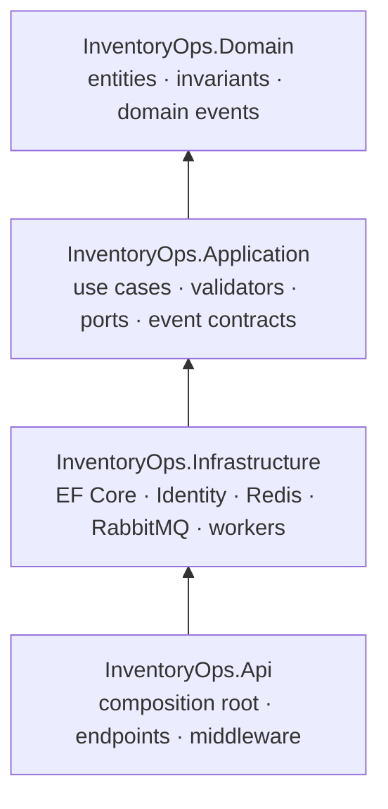

# Architecture

InventoryOps is a **modular monolith**: one backend deployable (`InventoryOps.Api`) that contains every business module, plus a separately deployed React SPA served by nginx. SQL Server, Redis and RabbitMQ are infrastructure used by that single backend.

## Layers and dependency rules

| Project | Owns | Must not reference |
|---|---|---|
| Domain | Aggregates (`Product`, `InventoryItem`, `Order`), value objects (`Sku`, `Money`), domain events, `DomainException` | Application, Infrastructure, Api, EF Core, ASP.NET Core, FluentValidation, Redis, RabbitMQ |
| Application | Use-case handlers per module, validators, persistence/cache ports, read-store ports, integration event contracts | Infrastructure, Api, EF Core, ASP.NET Core, SqlClient, Redis, RabbitMQ |
| Infrastructure | `InventoryOpsDbContext`, entity configurations, migrations, repositories, read stores, unit of work, Identity user admin, Redis cache store, outbox dispatcher, activity consumer, database initializer | Api |
| Api | `Program`, endpoint mapping, auth/CSRF/rate-limit/exception middleware, health, OpenAPI | – |

These rules are executable: `InventoryOps.ArchitectureTests` fails if a type violates them.

## Modules

| Module | Responsibilities | Public contract used by other modules |
|---|---|---|
| Catalog | Products, categories, product queries (cached details) | `ICatalogModule.GetProductsAsync` → `CatalogProductSnapshot` |
| Inventory | Stock positions, adjustments, thresholds, movements | `IStockReservations` (reserve/release/fulfil), `IInventoryProvisioning` |
| Orders | Submission, idempotency, state transitions, order queries | – |
| Dashboard | Backend-computed operational metrics (cached) | – |
| Activity | Projection of integration events into the activity feed | – |
| Identity | Roles, policies, user administration port | – |

Rules enforced by tests:

- Domain namespaces of different modules never reference each other (`Domain.Orders` knows nothing about `Domain.Inventory`; it receives an `OrderProduct` snapshot).
- An application module may only use another module's `*.Contracts` namespace.
- Endpoints never depend on EF Core, the persistence namespace or aggregate types.

### Why contracts instead of shared entities

`SubmitOrderHandler` needs product data and stock reservations. Calling `ICatalogModule` and `IStockReservations` keeps each module the sole owner of its tables and rules: Orders cannot accidentally change `InventoryItem.Reserved` without going through the inventory aggregate. Because both modules run in the same process and use the same `DbContext`, the calls participate in the caller's transaction.

## Request flow

1. nginx forwards `/api/*` to the API (same origin, so cookies and CSRF tokens are first-party).
2. Middleware: forwarded headers → exception handler → correlation id → security headers → request logging → authentication → rate limiting → authorization → antiforgery validation for unsafe methods.
3. The endpoint binds the request (unknown JSON properties are rejected) and calls one application handler.
4. The handler validates, then runs its work inside `IUnitOfWork.ExecuteAsync`.
5. Errors become RFC 9457 problem details in `GlobalExceptionHandler`.

## Transactions and concurrency

`EfUnitOfWork.ExecuteAsync` opens a transaction, runs the operation, calls `SaveChanges` and commits. `SaveChanges` also converts collected domain events into outbox rows, so **business data and the events describing it commit atomically**.

Stock rows, products and orders carry a `rowversion`. If two transactions read the same `InventoryItem` and both try to reserve, the second `UPDATE ... WHERE RowVersion = @original` affects zero rows; EF Core raises `DbUpdateConcurrencyException`. The unit of work then:

1. clears all tracked state,
2. waits a jittered exponential backoff (15 ms, 30 ms, …),
3. re-runs the whole operation, which reloads fresh stock and re-evaluates the domain rule (`quantity ≤ Available`),

up to 6 attempts, then returns `409 concurrency_conflict`. SQL Server deadlocks (error 1205) are retried the same way. The operation delegate therefore must be re-runnable and contain no non-transactional side effects (cache invalidation happens after commit, outside the delegate).

Reservations for multi-line orders are applied in product-id order so concurrent transactions touch rows in the same order. Check constraints (`Reserved <= OnHand`, non-negative quantities) are the final guard if code ever bypassed the aggregate.

The database runs with `READ_COMMITTED_SNAPSHOT`: readers see the last committed version without blocking writers; writers still serialise on the row and the optimistic check always compares with the latest committed version.

See [ADR 0002](adr/0002-optimistic-concurrency-for-stock.md) for the alternatives considered.

## Idempotent order submission

- Clients must send an `Idempotency-Key` header (1–64 characters) with `POST /orders`. The SPA creates one key per order form, so double clicks and retries reuse it.
- **Scope:** per authenticated user (`CreatedBy`). **Ownership:** stored on the order itself (`IdempotencyKey`, `RequestHash`) with a unique index on `(CreatedBy, IdempotencyKey)`. **Retention:** as long as the order exists (orders are never deleted).
- Before work starts the handler looks for an existing order with that key: same request hash → return it (`200`); different hash → `409 orders.idempotency_key_reused`.
- Two concurrent requests with the same key both pass the pre-check; the unique index lets only one commit. The loser catches the unique violation, finds the winner's order and returns it. An integration test fires five concurrent submissions with one key and asserts a single order and a single reservation.
- Failed submissions (validation, insufficient stock) persist nothing, so the same key can be retried after fixing the input.

## Synchronous versus asynchronous work

| Synchronous, transactional | Asynchronous, eventually consistent |
|---|---|
| Stock adjustments and reservations | Activity feed projection |
| Order submission and transitions | (future) notifications, integrations, analytics |
| Product changes, uniqueness checks | |

The activity feed typically lags by well under a second; the UI says so and polls every 15 seconds.

## Messaging

- **Outbox:** `messaging.OutboxMessages` rows are claimed in batches with `UPDLOCK, READPAST` and a 60 s lease, published with publisher confirms (`mandatory`, persistent), and marked processed after the confirm. A crash between confirm and update republishes the message: delivery is at-least-once.
- **Failure policy:** broker unavailability leaves rows pending without consuming attempts; per-message failures (nack/unroutable) retry with exponential backoff and are parked after 10 attempts.
- **Topology:** `inventoryops.events` (topic) → `inventoryops.activity` (quorum, `x-delivery-limit=5`, DLX `inventoryops.dlx`) → `inventoryops.activity.dlq`.
- **Consumer:** hosted inside the API, manual acks, prefetch 16; inbox row + activity entry in one transaction; malformed messages are dead-lettered immediately.
- **Contracts:** versioned event types (`*.v1`) distinct from domain events, mapped in one place (`IntegrationEventMapper`).

See [ADR 0003](adr/0003-transactional-outbox.md).

## Caching

Cache-aside through the `ICacheStore` port (Redis implementation). Product details, categories and the dashboard summary are cached with explicit TTLs; invalidation happens after commit; failures degrade to uncached reads. Inventory and order data are never cached. Details are in the README's Redis section.

## Frontend architecture

- `features/<module>` hold pages, feature components, TanStack Query hooks (`api.ts`) and Zod schemas; `components/ui` holds design-system primitives; `components/shared` holds cross-feature building blocks.
- Server state lives in TanStack Query; mutations invalidate affected query keys (no optimistic updates for stock or orders).
- List state (search, filters, sort, page) lives in the URL.
- Permissions from `/auth/me` hide unavailable actions; the API remains the authority.
- A 401 from any data request clears cached data and sends the user to the login page with a "session expired" message.
- Routes are lazy-loaded; vendor code and the chart library are separate, long-lived chunks.
